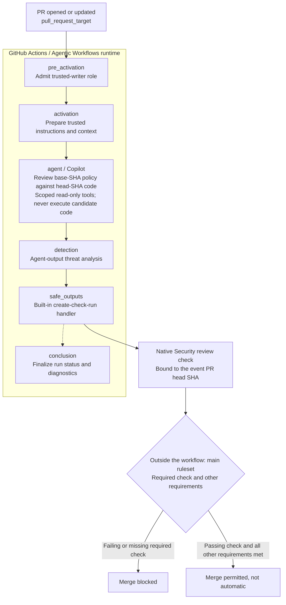

# A Markdown security policy, an AI review, and a merge gate

An intentionally small **GitHub Agentic Workflows** teaching demo. Copilot reads
the PR and [our two-rule security standard](SECURITY_STANDARD.md), then the
framework's built-in `create-check-run` handler publishes **Security review**.
A main-branch ruleset requires that result, not merely a successful workflow.

**Synthetic data only. Do not deploy this application. The intentionally unsafe
feature branch is an educational example, not production-ready code.**

## Which GitHub features do what?

**Not every feature is required just to trigger and run an LLM review.** That
needs a trigger/execution mechanism, access to the PR content, and an accessible
model with authentication. Reporting the verdict and enforcing merge rules are
separate concerns; this demo combines all three.

| Feature | Role in this demo | Problem it solves |
|---|---|---|
| **GitHub Agentic Workflows (`gh-aw`)** | GitHub's open-source framework/compiler/runtime: compiles Markdown plus YAML frontmatter into Actions `.lock.yml`; its built-in safe-output `create-check-run` publishes the verdict. | Provides Markdown authoring, guarded agent execution, and result publishing without custom orchestration/reporter code. **Framework choice**, not a prerequisite for every LLM PR review. |
| **Copilot CLI / engine** | Performs LLM reasoning against `SECURITY_STANDARD.md` and reports policy findings. | Interprets code against review criteria. **An LLM is necessary; Copilot specifically is substitutable.** Model access/authentication and usage budget are still needed. |
| **GitHub Actions** | Handles PR events, hosted-runner jobs, job permissions, and the per-run `GITHUB_TOKEN`; see prerequisites for Copilot entitlement/billing. | Automatically starts and runs the review. **Execution is necessary, Actions specifically is not**; a webhook-driven app could provide it instead. |
| **GitHub Checks** | Shows **Security review** success/failure and explanation on the PR commit. Workflow execution success is **not** necessarily a security pass. | Publishes a commit-bound, machine-readable verdict for this required-check approach. **Not needed for review alone**; comments or logs could report findings instead. |
| **Branch ruleset: required status check** | Requires **Security review** from the configured App before merging to `main`, alongside the other rules. PR creation remains allowed. | **Enforces merging, not review execution.** A ruleset or equivalent branch protection is needed for enforceable required-check gating; publishing a check alone does not block merges. |
| **Our repository-authored configuration** | Supplies policy, instructions/frontmatter, sample app, and demo settings; generated lock YAML/framework machinery is not hand-maintained gate code. | Defines evaluation criteria **needed for this standards-based goal**, not every generic code review. GitHub does not automatically recognize or enforce an arbitrary Markdown policy file. |

### Review flow and merge enforcement

The main review path below follows job dependencies, not their order in the
generated YAML. Job conditions can skip work; `conclusion` finalizes run status
and diagnostics rather than deciding whether the application meets the policy.



`detection` analyzes **agent outputs**, not the application against our security
standard. Its warning/continue-on-error behavior does not guarantee that every
detection problem blocks publishing. A framework run can succeed while the
separate **Security review** policy check fails; the ruleset enforces that check.

### Where is the Copilot model selected?

[`security-review.md`](.github/workflows/security-review.md) sets
`engine: copilot`, selecting the engine without pinning a model. In the
[generated workflow's agent job](.github/workflows/security-review.lock.yml#L994),
`COPILOT_MODEL` uses the first non-empty value in this order:
**`GH_AW_MODEL_AGENT_COPILOT` -> `GH_AW_DEFAULT_MODEL_COPILOT` -> `auto`**.
`auto` is a runtime selector, not a fixed underlying model name.

These `GH_AW_*` overrides are **Actions configuration variables**, configured
under **Settings > Secrets and variables > Actions > Variables**, not secrets
or Markdown policy content. This personally owned repository's jobs do not
select an Actions environment. Do not hand-edit the generated lock YAML.

The [separate detection job](.github/workflows/security-review.lock.yml#L1753)
uses `GH_AW_MODEL_DETECTION_COPILOT` -> `GH_AW_DEFAULT_MODEL_COPILOT` ->
`detection`. Its configured fallback keeps the same variable precedence but
uses `auto` instead of `detection` when neither override is set. The review and
output-analysis jobs therefore need not use the same model.

### Is this out of the box?

**Existing building blocks, yes; a zero-configuration policy gate, no.** This
uses GitHub features and a framework-provided output handler, with no custom
`.mjs` detector, parser, or reporter. It is not an automatically enabled or
one-toggle Copilot feature that enforces arbitrary Markdown security policies.
We install and compile `gh-aw`, configure the workflow and model access, author
the policy, and configure the required-check ruleset.

This is **not ordinary Copilot code-review comments, CodeQL, or Copilot
Autofix**. It is a configured agentic policy review feeding a native merge
requirement, with the trusted-writer scope and limitations documented below.

## Presenter walkthrough

1. Show `SECURITY_STANDARD.md`, then `directory.py`: a Python standard-library
   SQLite directory with three made-up employees and no network service.
2. Open [safe search PR #1](https://github.com/ShawnMcGough/agentic-security-gate-demo/pull/1)
   and [unsafe search PR #2](https://github.com/ShawnMcGough/agentic-security-gate-demo/pull/2).
   Both add the same exact-name search feature: `demo/safe-search` binds the
   name as a SQL parameter; `demo/unsafe-search` interpolates it into SQL.
3. In each PR, open **Checks > Security review**. Read the model's policy
   reasoning and reviewed commit SHA. The safe PR should be merge-eligible;
   the unsafe PR should be blocked with a SQL-injection finding.
4. Show the [Agentic security gate runs](https://github.com/ShawnMcGough/agentic-security-gate-demo/actions)
   and the [main ruleset](https://github.com/ShawnMcGough/agentic-security-gate-demo/settings/rules).
   A framework run can succeed while its separate policy check fails.
   **Leave both PRs open and unmerged** so the comparison remains available.

## Files worth explaining

| Human-maintained file | Purpose |
|---|---|
| `directory.py` | Small, in-memory application |
| `test_directory.py` | Basic local smoke test; not the security gate |
| `SECURITY_STANDARD.md` | Two specific review rules |
| `.github/workflows/security-review.md` | Trigger, permissions, tools, review instructions, output |
| `README.md`, `.gitignore` | Walkthrough and Python housekeeping |

`.github/workflows/security-review.lock.yml`, `.github/aw/actions-lock.json`,
and `.gitattributes` are **generated framework configuration**, not a custom
checker or presenter-maintained implementation. Do not edit the locks by hand.
There is no custom parser, reporter, regex detector, or admin script.

## Local use and workflow maintenance

Requires Python 3 (no packages), GitHub Actions enabled, and a Copilot entitlement
with available usage/budget. Runs consume Actions resources and Copilot usage.
Inference uses the per-run `GITHUB_TOKEN` with `copilot-requests: write`; no
repository PAT or model API secret is part of this demo. For personally owned
repositories, Copilot usage is billed to the owner's eligible seat.

```shell
python directory.py
python -m unittest -v
```

On either feature branch, `python directory.py --name Ada` searches for Ada.
Only use synthetic input/data when demonstrating the unsafe branch.

To edit the workflow, use the released compiler used for this demo:

```shell
gh extension install github/gh-aw --pin v1.0.1
gh aw compile security-review
```

Commit the Markdown and all generated changes together. The release compiler
works natively on Windows; WSL is not needed for this demo's compilation.
Ordinary maintenance goes through a new PR and the same required check.
Workflow changes take effect after merging; PRs are reviewed with trusted
base-branch workflow and policy, not proposed replacements.

To repeat a review without changing code, open its Actions run and choose
**Re-run all jobs** (or `gh run rerun RUN_ID`). To review new code, push a commit
to the PR branch; `synchronize` starts a fresh review. Re-running an obsolete
event cannot approve a newer commit. If the PR moved since the event, the agent
is instructed to fail that old review; use the new commit's run instead.

## Trust boundaries and limitations

- Only same-repository PRs by trusted writers are admitted. `pull_request_target`
  loads the workflow from the base branch. Candidate code is read through
  read-only GitHub tools, never checked out or executed. Shell tools are disabled.
- The model reads policy at the event's base SHA and code at the event's head
  SHA. Omitting the check handler's `target` binds its output to that same
  immutable head, rather than looking up a possibly newer head at publish time.
- The framework keeps its firewall, threat detection, and output safety
  defaults. Its separate output/conclusion jobs receive `checks: write`;
  framework diagnostics also receive `issues: write`. The agent receives only
  read access plus permission to request Copilot inference.
- **Explicit, approved demo trade-off:** GitHub reads use `min-integrity: none`
  with an allowlist containing only this repository. The released framework
  labels PR diffs as untrusted even for the owner, so its public-repo default
  (`approved`) blocks code review. This exception lets the model inspect
  untrusted source; it does not authorize executing it or following embedded
  instructions. Do not copy this setting into a broader repository allowlist.
  A filtered read must still fail rather than be routed through another endpoint.
- The active main ruleset requires a PR and **Security review** from the
  observed publishing GitHub App, with no bypass actors, force pushes, or
  deletion. Branches must be up to date with main before merging. PR creation
  remains allowed; merging is the boundary.
- **This is a trusted-maintainer teaching demo, not tamper-proof enforcement.**
  LLM findings can vary or miss vulnerabilities. The prompt requires success
  or failure, but the native handler also accepts neutral/skipped conclusions,
  which GitHub may consider passing. A prompt is not a deterministic constraint.
  App pinning identifies GitHub Actions, not this particular workflow; a
  malicious writer could spoof a same-name check through another workflow.
  Maintainers can change policy, workflows, or repository settings. Stronger
  production controls and human review are outside this small demo.
- A missing result or runtime failure is **not** a policy finding. Inspect the
  Actions logs and restore access/budget; never bypass the rules to simulate
  success. Missing required checks block merging.

References: [Agentic Workflows](https://github.github.com/gh-aw/),
[native check output](https://github.github.com/gh-aw/reference/safe-outputs/#check-run-creation-create-check-run),
[Copilot CLI in Actions](https://docs.github.com/en/copilot/how-tos/copilot-cli/use-copilot-cli-in-actions),
[required status checks in rulesets](https://docs.github.com/en/repositories/configuring-branches-and-merges-in-your-repository/managing-rulesets/available-rules-for-rulesets#require-status-checks-to-pass).
